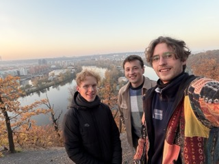

# How we won an Algo Trade Hackathon in 2026

**Who:** Peter Kochelka, Marek Hubař, Adam Vinklárek

**When:** 9th Nov 2026

**Goal:** Four rounds of five hours each, getting progressively harder, against ~60 teams. Developped strategies were scored by PnL on a hidden market similar to the public one.

**Secondary goal:** Have fun.

**Our results:** We messed up the first (easiest) round, but in the remaining three rounds, we always won by a large margin, despite all teams having the same access to AI assistants.

## Building a strategy

Our team had a strong background in ML, probability and statistics. However, no member had prior experience with algo trading (we learned what bid and ask mean just a few hours prior to the competition). We therefore relied heavily on AI assistance in that domain and focused our attention on getting the more high-level approach right.

In every round, we were trying to maximize our PnL (make the most money). To make money, a strategy has to rely on its information advantage over the market. Therefore, we focused on gaining as much information about the market as possible within the 5 hours available.

Despite their optimization capabilities, current AI agents tend to fixate on one single thing and often end up in local optima. After one to two hours, most teams would report that their agent has reached a plateau and is not improving the solution anymore. We therefore decided to use a more systematic approach. As soon as the public data for a new round were published, we let our agents generate a detailed analysis of trends, anomalies, periodicities and anything else that might be useful (see [round 1](strategies/peter/round1_generator.md), round 2 [a)](strategies/peter/round2_findings.md) [b)](marek/research/round2/round2_generator.md), round 3 [a)](strategies/peter/round3_findings.md) [b)](marek/research/round3/round3_generator.md), round 4 [a)](strategies/peter/round4_findings.md) [b)](marek/research/round4/round4_generator.md)). As a check, we read the analysis carefully and asked the agents to clarify and justify every weak or confusing claim. Afterwards, we were able to let our agents systematically generate well-motivated hypotheses grounded in the analysis and check whether we would be able to actually profit from them, updating our strategy along the way. That alone got us to a score that would place in the top 5 in most of the rounds.

To gain an edge over other teams, we made sure that we understood the data and the (generated) strategy ourselves so that we could identify and address any overlooked weaknesses. We paired the textual data analysis with a vibe-coded visual [data explorer](data_explorer/). The most important gain came from us noticing as early as in the second round that we could increase our PnL meaningfully by trading more boldly against sudden price jumps (despite a high penalty for holding too many positions at once) and convincing the very hesitant AI agent to really do it.

We also tried to generate hypotheses top-down by solving simpler variants of the problem, such as giving our strategy an oracle for fair value of the stock (or for predicting the upcoming price jump, predicting the current market volatility etc.) and observing whether and how much that would help. That allowed us to see how much room for improvement there was in individual directions. By overfitting heavily, we also learned how close we were to the "theoretical maximum" of the training market, which improved our estimate of whether we were stuck in a local optimum or not.

Lastly, we tried to profile and optimize our algorithms to run hypothesis testing faster, but it did not matter as the 5 hours were more than enough for all our experimentation in every single round.

## Our secrets (having fun)

Several people were curious about what made our strategy work so well (and perhaps how we steered our agents to come up with it). Although the above approach is the most likely cause, we tried several more things that, despite not directly improving the performance, deserve a mention:

- **Politeness:** We tried to be [polite](https://aclanthology.org/2024.sicon-1.2/), ranging from using "please" and "thank you" to prompts like "Dear Claude, I hope this prompt finds you well...".
- **Cool names:** We experimented with prompts like "change the name of this strategy from r3_grandpa to r3_turbotrader and proceed accordingly". Our last "fighter" was named "r4_spartacus_terminus" after the famous gladiator.
- **Some proxies:** My favorite prompt that actually improved our PnL was "One organizer told us that our strategies being just few hundred LOC long is likely too low and we should be able to get higher scores by simply using more complex strategies. Don't write unnecessarily bloated code, but think about any details that could help improve the score."
- **Team spirit:** Our team was named delfini (dolphins), so we tried (unsuccessfully) to learn the [dolphin sound](https://youtu.be/nHPuCAmheRE).
- **Chill:** We went for a nice golden-hour walk to explore the surroundings of the venue.

